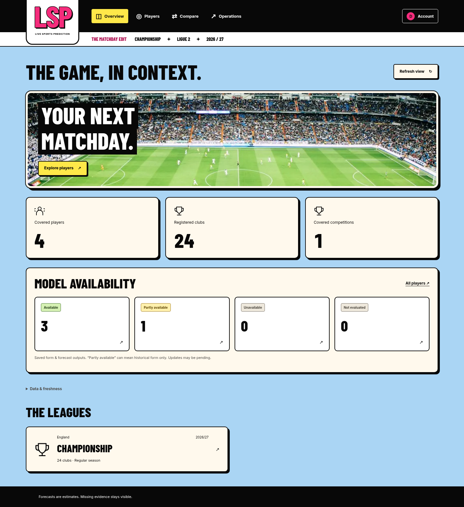
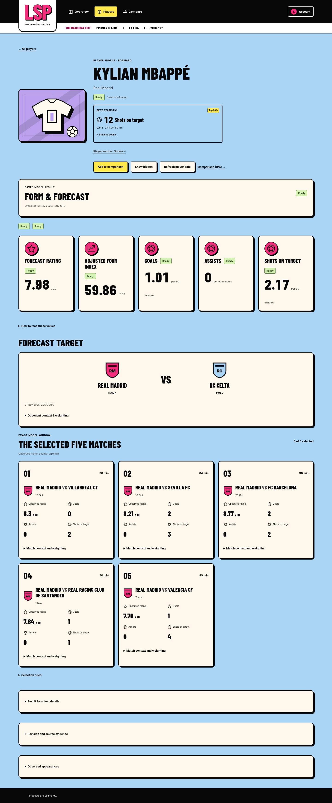

# Live Sports Prediction

A football player analysis project built around five qualifying league appearances,
with opponent strength and competition context informing an explainable forecast.

The application provides database-backed sign-in, authenticated football APIs,
player comparison, administrator operations, and a recoverable data worker.
Imports preserve source responses, normalize fixtures and player statistics,
reconstruct historical standings, and save forecasts with immutable input
evidence. The website includes an overview, searchable player catalogue, detailed
forecast evidence, player comparisons, and restricted administrator operations.
The image-led interface uses locally served football photography and generic
position artwork, with detailed evidence available in expandable sections.
Photographs are illustrative; asset sources and licenses accompany the files.

## Requirements

- Node.js 24 and npm 11
- Docker Engine compatible with PostgreSQL 17 and MongoDB 8, with Docker Compose
- Git; a Linux shell for the command examples

## Run locally

```bash
git clone https://github.com/DevaOnL/Live-Sports-Prediction.git
cd Live-Sports-Prediction
npm ci
umask 077
cp .env.example .env
chmod 600 .env
```

Replace all placeholder database passwords in `.env` with independent random
values of at least 16 characters. Set `BETTER_AUTH_SECRET` to an independent
random value of at least 32 characters; `openssl rand -hex 32` generates one.
Keep that secret stable across restarts. Keep `.env` local and ignored by Git.
`AUTH_BASE_URL` is the exact browser origin, initially `http://localhost:3000`;
HTTPS is required for non-loopback origins. Leave `INGESTION_ENABLED=false` until
ingestion is configured. Login and stored-data reads need no football API key.

Use free host ports 3000, 5432 and 27017 for the default configuration. The
[deployment guide](docs/deployment.md) explains separate installations, HTTPS,
upgrades and matched database backups. Preserve the same Compose project name
when restarting an existing installation so it keeps using its volumes.

```bash
docker compose config --quiet
docker compose up -d --wait postgres mongo
```

PostgreSQL and MongoDB bind to loopback ports 5432 and 27017. Provision SQL and
create local users below before starting the app. The Compose app receives only
the authentication secret and restricted PostgreSQL reader/writer/auth credentials.
The enabled Compose worker receives writer/MongoDB ingestion credentials and the
provider key. Neither app nor worker receives bootstrap or migrator credentials.

```bash
docker compose ps
```

Named volumes preserve database data when containers are stopped or replaced.
Database initialization occurs only on empty volumes; editing `.env` does not
rotate an existing database password. A normal `docker compose down` retains
volumes. Deleting volumes destroys their stored data.

## Set up the relational database

With PostgreSQL running, provision its restricted logins and apply the migrations:

```bash
npm run db:provision
npm run db:migrate
```

Provisioning creates or updates the reader, writer, authentication, and migration
logins using the local password variables. Migration files run in order, each in
its own transaction, and their checksums are recorded. Rerunning the migration
command verifies the applied history and applies only new files. Apply schema
upgrades explicitly with `npm run db:migrate` while preserving existing volumes;
never edit an already-applied migration. Rerun provisioning only for deliberate
role setup or password rotation.

Existing installations must apply all migrations through `011_suspended_fixtures.sql`
before starting the current app and worker. This retains historical records while
retiring the former active leagues. Preserve volumes and applied migration files.

The [database guide](docs/database.md) documents the ER diagram, relational
constraints, role grants, migration behavior, and an isolated PostgreSQL test
recipe. Database tests create temporary databases and require a verified disposable
cluster. Run them only using that recipe or the dedicated CI service.

## Create users and start the app

Create viewer and administrator accounts with the local migrator CLI. Passwords
are accepted through stdin and must contain 12–128 characters. For example, in
Bash:

```bash
read -rs -p 'Viewer password: ' account_password
printf '%s\n' "$account_password" | npm run users -- create --email viewer@example.test --name 'Local viewer' --role viewer --password-stdin
unset account_password
docker compose up -d --build --wait app worker
```

Use the [session/API guide](docs/api.md) for the administrator creation command,
password changes, role changes and session revocation. There is no public signup
or password-reset endpoint. Open <http://localhost:3000/login> using the exact
configured origin. Sessions use HttpOnly cookies and authoritative SQL roles;
viewers cannot perform administrator operations. Sign-in opens `/overview`.
Use `/players` to filter covered players and select two to four for `/compare`.
Player pages separate the saved five-match window from current observations and
show missing evidence, output units, target context and freshness warnings.
Administrators can open Operations from Account settings (`/account`) to inspect
imports, jobs and audit records, queue
work, retry failures, and apply revisions with conflict checks. Queue acceptance
does not mean processing has completed. The underlying APIs are documented in
the session/API guide.

`GET /api/health` reports process liveness and configured feature flags without
querying a database. It does not prove database readiness or forecast freshness.
Database services authenticate their own health checks. The worker health
listener is internal on port 4001.

## Import covered football data

Register a free [Sorare account](https://sorare.com/), then create a developer API
key in [Developer settings](https://sorare.com/settings/developer). Put it in the
ignored local `.env` as `SORARE_API_KEY`. No purchase or deposit is required for
the verified developer API route. Review the provider
[API documentation](https://github.com/sorare/api) and account terms before signup.
Provision the restricted MongoDB identity after both database services are healthy:

```bash
npm run mongo:provision
```

Set `INGESTION_ENABLED=true` locally, then run an initial import and queued detail
work. Explicit `sync` and `once` commands can contact the provider even when that
worker flag is false. These commands use the restricted runtime identities:

```bash
npm run ingest -- sync
npm run ingest -- once
npm run ingest -- status
```

Recreate the worker after changing its environment with
`docker compose up -d --build worker`. The enabled worker polls every 15 minutes,
shares a 60-request rolling-minute application budget and one-second request
pacing with the CLI, and processes durable jobs. The initial import includes
full paginated rosters, both 380-fixture schedules, and queued match statistics;
it can take several minutes. Read the
[ingestion guide](docs/ingestion.md) for coverage, missing-data behavior, recovery,
and isolated PostgreSQL/MongoDB verification.

## Calculate forecasts

Apply pending migrations before starting an upgraded worker. Existing imports
can recover their latest Sorare roster observations from archived data without
provider requests:

```bash
npm run db:migrate
npm run ingest -- reconcile
npm run forecast -- refresh all
npm run forecast -- status
```

Use `npm run forecast -- show Player:UUID` with the native provider identifier to
inspect the current result, fixed five-match window, target, missing-data reasons,
and saved provenance. Saved API and CLI results describe the last completed
evaluation, with its cutoff and check time. Imports and target expiry refresh
asynchronously; an unchanged source ordinal alone does not establish freshness.
The comparison API evaluates current canonical inputs at a common read snapshot
without saving revisions. The enabled worker refreshes automatically after canonical
changes and checks target expiry every minute. CLI refreshes need PostgreSQL writer
credentials; comparisons use the restricted reader. Neither calculation needs a
provider key or MongoDB connection. See the
[forecasting guide](docs/forecasting.md) for formulas and availability rules.

## Database demonstrations

Run `npm run demo` after `npm ci` to execute the SQL and MongoDB examples on
fresh disposable Docker containers. It uses synthetic data, independent temporary
credentials, and no football API calls. Existing project databases and volumes
are untouched. The [demonstration guide](docs/demo.md) maps each example to its
source, expected result, and safety checks.

The archived `v1.0.0` release supports `npm run replay --silent` to demonstrate a
real historical sixth appearance using a matched archived-source snapshot in an
isolated installation. It reads through `lsp_reader` and writes only to its own
temporary PostgreSQL clone. The protocol is source-specific and does not select
current Sorare records; do not re-enable former leagues in the current app. The intentionally withheld appearance
first produces incomplete history; restoring it advances the selected five and
creates a refreshed revision. The [replay guide](docs/replay.md) explains
prerequisites, isolation and the distinction from historical accuracy.

## Development

Stop the app container before running the local development server on port 3000:

```bash
docker compose stop app
npm run dev
```

Host development and CLI processes load the local `.env`; Compose explicitly
limits each container's environment as described above. Keep administrative
credentials out of deployed application environments.

Run the worker separately with `npm run worker`. With ingestion disabled, it
exposes `GET /health` without database connections or jobs. With ingestion enabled,
it runs imports and queued processing. Web health is available at `GET /api/health`.

```bash
npm run lint
npm run typecheck
npm run test:unit
npm run build
```

The lockfile pins npm dependency versions. GitHub Actions runs installation, lint,
type checking, and the production build without database or API credentials. A
separate job verifies migrations, constraints, ingestion, forecast persistence,
refresh processing, observation replay, frozen evaluation, worker crash recovery, reporting permissions,
sessions/roles, authenticated HTTP APIs,
browser journeys, and isolated database demonstrations against disposable
PostgreSQL 17 and MongoDB 8 services. `npm run test:auth` needs the guarded PostgreSQL test recipe;
`npm run test:api` also needs the guarded MongoDB server and a preceding
`npm run build`. See the database and ingestion guides before running either.
With the same isolated cluster guards, run `npx playwright install chromium` and
`npm run test:ui` for real browser checks of viewer/admin flows and responsive
layouts. Linux hosts may need `npx playwright install --with-deps chromium`.
An existing compatible browser can be selected with
`PLAYWRIGHT_CHROMIUM_EXECUTABLE_PATH`. Browser tests seed synthetic data, block
external browser requests and do not call the football provider. The
[evaluation guide](docs/evaluation.md#run-and-verify) also covers isolated worker,
evaluation and expanded accessibility checks.

## Methodology

The analysis uses the latest five finalized appearances with at least
60 reported minutes each. A shorter appearance leaves that window unchanged.
Opponent and own-team strength provide context for an overall rating and selected
position-specific statistics. Counts represent decimal estimates under a
90-minute playing-time assumption. Missing data must remain distinct from zero.

Active coverage is restricted to Premier League (`premier-league-gb-eng`) and
La Liga (`laliga-es`), 2026/27, through the free registered Sorare developer API.
Both use the top-five-league coefficient of 2. A conventional 0–10 player rating
and key passes are not supplied by this source; those outputs remain unavailable.
Other count forecasts depend on finalized, complete evidence for the selected five.
Sorare fantasy scores are never relabeled as conventional ratings. Free API
availability can change; missing and provisional data remain explicit.

Catalogue cards and profiles show an observed Best statistic when a player has
a complete eligible five-match window and at least ten comparable players in the
same position, league and season. Ranking uses per-90 rates; Top 20% requires a
conservative percentile of at least 80. Open the evidence for the observed total,
minutes and cohort. This is a scouting summary, separate from a forecast.

Former-league records remain stored for audit and frozen historical evaluation;
they are excluded from current product reads, imports and jobs. Forecasts are fixed heuristic
estimates, with no established predictive accuracy or calibrated probability.
The [evaluation report](docs/evaluation.md) separates live output availability
from historical accuracy, documents the frozen protocol and coverage, and provides
reader-only historical and forward-measurement commands for reproducing the
archived source protocol in a separate installation. Current Sorare accuracy has
not been measured.

## Technology

Next.js and TypeScript provide the web interface and a shared language for server
and worker code. PostgreSQL stores canonical relational records and enforces
constraints; MongoDB stores immutable source archives and separate import metadata.
Docker Compose provides a reproducible local environment with persistent database
volumes. Inter is
self-hosted through the application bundle.

## Documentation

| Guide | Contents |
| --- | --- |
| [Architecture](docs/architecture.md) | Implemented data flow, credential boundaries and technology choices |
| [Database](docs/database.md) | ER diagram, relational schema, constraints, grants and migrations |
| [Ingestion](docs/ingestion.md) | Approved real-data coverage, mapping, request budget and recovery |
| [Forecasting](docs/forecasting.md) | Exact-five selection, formulas, units and unavailable states |
| [API and authentication](docs/api.md) | Account administration, sessions, viewer reads and administrator commands |
| [Evaluation](docs/evaluation.md) | Frozen historical coverage and private forward measurement |
| [Deployment](docs/deployment.md) | Local/HTTPS operation, upgrades, coordinated backups and restore |
| [Database demonstrations](docs/demo.md) | Executable SQL and MongoDB examples with isolated synthetic data |
| [Historical observation replay](docs/replay.md) | Real-data sixth-appearance window replacement in an isolated PostgreSQL clone |
| [Requirement traceability](docs/requirements.md) | Assignment deliverables, executable evidence and limitations |

## Interface examples

Captured on 2026-11-10 from the implemented application using isolated synthetic
data and example accounts. These show interface behavior, not live coverage or
measured accuracy. Photography is illustrative; the player artwork is generic.





[Comparison](docs/screenshots/comparison.png) ·
[Administrator operations](docs/screenshots/administration.png).
The [screen guide](docs/requirements.md#screen-evidence) describes the journeys
and their test prerequisites. A fresh installation is empty until data is imported.
