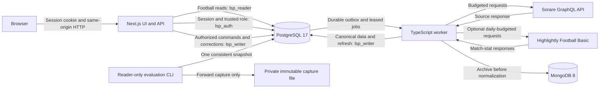

# Architecture and technology choices

Live Sports Prediction is a self-hosted football application with a Next.js
interface, PostgreSQL canonical records, MongoDB source archives and a separate
TypeScript worker. It produces an explainable fixed heuristic from five eligible
appearances, retaining the evidence and reasons for unavailable outputs. Observed
statistics, adjusted form and next-match forecasts remain distinct.

Current coverage is Premier League (`premier-league-gb-eng`) and La Liga
(`laliga-es`), 2026/27 regular seasons, through Sorare's registered free developer
API. Both have 20 clubs and coefficient 2, with London/Madrid local cutoffs.
Access was verified on 2026-11-10 and can change. The [ingestion guide](ingestion.md)
defines the source/allowlist; [forecasting](forecasting.md) defines the model.
Optional Highlightly Football Basic supplementation supplies verified missing
match-stat fields within the same coverage; Sorare remains the primary source.
Archived APIFootball evaluation/replay protocols retain their original two-league
scope and dated results; they do not measure the current source.

## Components and data flow

| Component | Implemented responsibility | Main code |
| --- | --- | --- |
| Next.js App Router and React | Public homepage/login; protected overview, catalogue, player detail, comparison, account and administrator screens | [`src/app`](../src/app/), [`src/components`](../src/components/) |
| HTTP boundary | Validated parameters/bodies, session lookup, viewer/admin checks, canonical-origin mutation checks, bounded no-store responses | [`handler.ts`](../src/server/web/handler.ts), [`http.ts`](../src/server/web/http.ts), [`access.ts`](../src/server/web/access.ts) |
| Read and administrator services | Parameterized SQL, coherent read snapshots, idempotent audited commands and optimistic metric corrections | [`read.ts`](../src/server/api/read.ts), [`admin.ts`](../src/server/api/admin.ts) |
| PostgreSQL | Football entities, optional supplement observations/effective reads, constraints, provenance, rosters, standings, forecasts, auth storage, audit, outbox and jobs | [`db/migrations`](../db/migrations/), [schema and ER diagram](database.md) |
| MongoDB | Immutable per-page source captures in versioned bundles and separate validation/import state | [`archive.ts`](../src/server/ingestion/archive.ts), [`mongo.ts`](../scripts/mongo.ts) |
| Worker | Source polling, optional budgeted supplementation, archive reconciliation, statistics jobs, standings reconstruction and local forecast refresh | [`src/worker`](../src/worker/), [`runtime.ts`](../src/server/ingestion/runtime.ts), [`enrichment.ts`](../src/server/ingestion/enrichment.ts) |
| Forecast engine/store | Exact-five selection, context and missing-data rules, deterministic calculation, immutable revisions and current heads | [`src/server/forecast`](../src/server/forecast/), [model guide](forecasting.md) |
| Source profiles and scouting | Explicit current/archived provider identities and guards; observed best statistics ranked against full eligible cohorts | [`sources.ts`](../src/server/ingestion/sources.ts), [`highlights.ts`](../src/server/scouting/highlights.ts) |
| Evaluation tools | Frozen historical scoring and separately versioned forward capture/scoring without sports-data writes or provider requests | [`evaluate.ts`](../scripts/evaluate.ts), [`measure.ts`](../scripts/measure.ts), [evaluation guide](evaluation.md) |
| Real-data replay | Read a source snapshot with the restricted reader, then demonstrate sixth-appearance arrival and queued refresh in an owned disposable PostgreSQL clone | [`replay.ts`](../scripts/replay.ts), [replay guide](replay.md) |

The browser receives application responses. Database connections and provider
credentials remain server-side. Native `Player:UUID`, `Club:UUID` and `Game:UUID`
identities remain separate from stored Sorare lookup slugs. Attribution links use
those genuine slugs. The current adapter preserves nulls, accepting explicit
matching detailed-stat zeros; it never substitutes fantasy scores for ratings or
won tackles for total tackles. Ratings/key passes remain missing where unsupported.
Optional supplements fill only missing rating, key-pass, tackle and interception
fields after strict fixture/player matching. Primary values, including zero,
take precedence; both primary appearance and fixture revisions anchor each
supplement. The shared effective view supplies source/revision/time evidence
without exposing private matching details. Primary corrections invalidate older
supplements, and separate freshness fields prevent recent supplements from
masking stale Sorare observations.
Administrator source commands enter SQL work queues; the web process
does not call the football provider. Local CLI tools are separately controlled
operational entry points and do not authenticate a web session.

## Import and recovery boundaries

An import has four steps:

1. Reserve each actual HTTP attempt against the shared 60-per-rolling-minute
   SQL budget, with one-second spacing. Fetch allowlisted GraphQL pages and
   archive a versioned capture bundle in MongoDB. Each page keeps its exact query,
   credential-free variables, response text and actual retrieval time; SHA-256
   identifies the bundle. Incomplete captures cannot establish roster/schedule
   completeness.
2. Validate and normalize it without turning absent metrics into zero or treating
   an absent player row as a confirmed DNP. Validation issues remain inspectable.
3. Commit canonical changes, source/normalized revisions, an ingestion batch
   marker, audit and outbox work together in PostgreSQL. Stable provider keys and
   deduplication keys make replay idempotent.
4. Mark the separate MongoDB import metadata with the SQL result after commit.

There is no distributed transaction across MongoDB and PostgreSQL. A source
response archived before a crash remains recoverable. A SQL commit followed by
a failed MongoDB marker write can be recognized through its durable SQL batch
marker and replayed without duplicating canonical changes. The worker reconciles
current-source archives before normal polling. Invalid observations remain archived
with issues; transient persistence failures are retried. Recovery commands and failure cases
are documented in [ingestion](ingestion.md#storage-and-recovery).

The optional supplement loop independently archives versioned Highlightly
catalogue/box-score bundles and reconciles its own import markers. It exhausts
the provider's reported catalogue pages, which can cover fewer fixtures than
Sorare's schedule. Missing supplementary matches remain unmapped and cannot
create DNP or change the primary five-match window. Matching supplements commit
append-only observations, source/normalized revisions and refresh outbox work;
only their current heads are mutable.

The MongoDB runtime role has `find`/`insert` on `raw_archives` and
`find`/`insert`/`update` on `import_metadata`. It cannot rewrite or delete source
archives. Strict collection validators and lookup indexes are provisioned by a
separate administrator command. MongoDB RUD examples use a disposable synthetic
annotation collection rather than authoritative archives.

PostgreSQL enforces foreign keys, uniqueness, checks and deferred context
constraints independently of TypeScript validation. Context-changing writes use
`READ COMMITTED`; constraint entry points reject incompatible isolation levels.
Read services use repeatable-read, read-only transactions. Locking can still cause
a deadlock, so an aborted write must be retried as a whole transaction. The
[database guide](database.md) explains these constraints and migration checksums.

## Durable work and forecast evidence

Outbox events commit with the changes that require follow-up work. The worker
dispatches deduplicated jobs, claims database leases, renews active leases and
records attempts, retry scheduling or terminal failure. Expired leases make
interrupted jobs recoverable. These are retryable jobs, not a promise of exactly
one execution; idempotent effects prevent repeated effective imports/revisions.

The worker polls source data every 15 minutes with an application-wide maximum
of 60 Sorare attempts per rolling minute and one-second request spacing. Every
cursor page and detail request consumes a reservation. Scheduled work and
administrator commands share that budget. A separate local queue loop continues
forecast processing while an upstream request is stalled or source work is budget-deferred. Canonical
changes, roster/standings events and time passing can all require refresh. A queue
submission means accepted, not completed; forecast requests can coalesce.

Highlightly uses a separate shared 100-request UTC-day allowance with one-second
spacing, provider-header reconciliation and five requests held in reserve. Each
HTTP attempt consumes a durable reservation, including failures. Bounded
backfilling, source-scoped cache reuse and budget deferral leave primary polling
and local forecast processing independent. See
[supplementation](ingestion.md#optional-match-stat-supplementation) for setup and
matching rules; no key is required when this optional flow is disabled.

Each saved forecast revision retains model version, semantic input hash, selected
appearances, target/context, full result and provenance. Runtime roles may append
revisions but cannot update or delete them. Active supplementary fields retain
their own source/revision IDs and observation times alongside the original
Sorare appearance and fixture lineage. A mutable head points to the current
revision and separately records the latest successful evaluation time/source
watermark. Identical semantic inputs reuse a revision; A-to-B-to-A corrections
append a third revision. A head-change trigger records audit and a
`forecast.updated` notification transactionally. That notification is excluded
from canonical refresh input to avoid a feedback loop.

Reading saved evidence does not recalculate it. The API/UI distinguish revision
time, latest check and current read watermark, and warn about changed inputs or
expired targets. Comparison instead computes two to four players from one current
read-only snapshot, persists no revision and makes no provider request. Its
canonical result and any prior stored revision are labeled separately. Catalogue
and profile best statistics independently summarize observed five-match counts,
using at least ten eligible same-position/league/season players across the full
cohort. They can be available while forecast ratings or future outputs are missing.

The archived [real-data replay](replay.md) copies an APIFootball reader-only snapshot
into an owned PostgreSQL 17 container with temporary storage. It preserves actual
source/roster times and the present cutoff, withholds one latest eligible
appearance, and requires the baseline to expose the resulting history gap. After
restoring the exact row, the normal queue/store path must append a revision with
the latest five and match the untouched snapshot's calculation. All writes stay
in that clone; no provider calls or source database writes occur. This demonstrates
data arrival and refresh on real records, not a forecast issued before the
restored match or an accuracy measurement.

Migration `010_current_coverage.sql` disables former product competitions and
seasons while retaining their evidence. It adds optional player/club lookup slugs
and provider-aware history, lineage and refresh routine overloads; original
routine signatures remain unchanged. Production runtime selects Sorare. Existing
synthetic HTTP/worker fixtures can select the archived profile only with the
explicit `LSP_TEST_SOURCE=legacy` selector inside a valid `_test` database.
Migration `012_appearance_enrichment.sql` adds optional supplement storage,
revision anchors, shared daily quota and `effective_appearances`; it also updates
the Sorare history routine to use the same effective fields as application reads.
Apply all pending migrations before starting the upgraded app/worker.

## Authentication and privileges

Better Auth 1.7.18 manages password authentication and PostgreSQL-backed sessions.
Only sign-in, session and sign-out HTTP endpoints are exposed. Accounts are
created through a controlled CLI; public signup, social login and password-reset
flows are disabled. Password/role administration revokes existing sessions.
The server looks up the SQL user role on every protected request; a browser role
or cached role never authorizes a command.

Sessions expire after eight hours. Cookie caching is disabled; cookies are
HttpOnly and SameSite=Lax, with Secure required for HTTPS. The shipped login uses
nonpersistent cookies with a nonrenewing server expiry; persistence is stored in
SQL independently of optional client cookies. Explicit persistent sessions can
renew at the documented interval. Existing sessions retain their expiry and
become nonrenewing when migration 013 is applied. Database-backed login throttling is shared across app
instances. With no trusted proxy configured, per-endpoint buckets are shared;
caller-supplied forwarding headers cannot create a new throttle identity.
Mutations require the exact configured Host and Origin. See [API access](api.md)
for account setup, session details and HTTP contracts.

| Boundary | Credentials/capability |
| --- | --- |
| Web process | Independent `lsp_reader`, `lsp_writer` and `lsp_auth` passwords, canonical auth origin and auth secret; no provider, MongoDB, bootstrap or migrator credentials |
| Reader | Canonical football/provenance/forecast and effective appearance reads; no direct supplement-table/quota access, SQL writes or auth/operational-table access |
| Writer | Canonical writes and bounded job/forecast-head updates; append-only source revisions, supplement observations, rosters, forecasts and audit; supplement-head/quota updates; no auth or migration administration |
| Auth | Required auth storage, session and limiter operations; cannot assign user roles or access football tables |
| Worker | PostgreSQL writer, restricted MongoDB archive identity, Sorare key and optional Highlightly key; no auth, bootstrap or migrator credentials |
| Controlled administration | Bootstrap provisioning and `lsp_migrator` schema/account administration stay outside app/worker containers |

Viewer/admin are application user roles; the SQL reader/writer/auth/migrator
logins enforce a separate storage boundary. Route authorization decides when the
web process may use its writer pool. The process holds that credential, so SQL
grants complement server authorization rather than replacing it. No per-user
PostgreSQL login or row-level ownership policy is claimed.

## Why these technologies

| Choice | Reason for this project | Tradeoff |
| --- | --- | --- |
| Next.js App Router, React and TypeScript | One typed application delivers the interface, guarded pages and same-origin APIs; server-only modules keep SQL/runtime credentials out of client code | A Node.js server is required; server/client boundaries, no-store responses and session checks need explicit care |
| PostgreSQL 17 | Relational membership/fixture integrity, transactional provenance/outbox writes, SQL reporting and database grants directly serve the DBMS requirements | Constraints, locks, migrations and role provisioning add complexity; unknown source evidence still cannot be repaired by a schema |
| Raw `pg` and versioned SQL | Parameterized queries, transaction isolation, grants, routines, triggers and recursive CTEs stay visible and executable for the database demonstration | Mapping, query validation and SQL maintenance are manual; no ORM supplies schema or migration abstraction |
| MongoDB 8 and official driver | Original response text can be retained alongside document metadata without forcing changing source shapes into canonical tables; validators/indexes and aggregation supply a concrete NoSQL demonstration | Two stores require reconciliation and coordinated operational backups; no cross-store atomic commit or vector search is implemented |
| Better Auth with database sessions | Session expiry/revocation and password hashing use a library while roles remain authoritative in SQL | Account administration is local; there is no email recovery/social-login service, and shared throttle buckets can affect legitimate users |
| Separate TypeScript worker and SQL outbox | Slow/budgeted provider work stays off HTTP requests; durable work survives restarts and local refresh can proceed independently of source requests | Availability is eventual, retries are observable, and one worker deployment plus lease/idempotency logic must be operated |
| Docker Compose | App, worker, PostgreSQL and MongoDB can be reproduced with explicit credentials and named persistence | This is a single-host deployment, without managed backups, automatic failover or horizontal database scaling |

Node.js 24/npm 11 and application dependency versions are declared in
[`package.json`](../package.json) and locked by
[`package-lock.json`](../package-lock.json). Database images are PostgreSQL 17
and MongoDB 8 as defined in [`compose.yaml`](../compose.yaml).

## Runtime, verification and limits

Compose binds web port 3000 and database ports to loopback; worker health port
4001 is internal. Named volumes retain PostgreSQL, MongoDB data and MongoDB
configuration across ordinary container replacement or `docker compose down`.
Initialization runs only for empty volumes. Schema upgrades apply pending
checksum-verified migrations explicitly and preserve existing data.

`/api/health` reports web process liveness and configured features without testing
database readiness. Enabled worker health checks database access and progress of
both processing loops; it does not guarantee provider availability, complete
source data or a forecast for every player. PostgreSQL/MongoDB container health
checks authenticate separately. HTTPS is required outside loopback and a reverse
proxy must preserve the canonical Host. Follow the [setup guide](../README.md)
and [deployment/recovery runbook](deployment.md). Dated
[interface examples](requirements.md#screen-evidence) show the implemented
screens with isolated synthetic demonstration data.

The [CI workflow](../.github/workflows/ci.yml) installs the committed lockfile,
checks lint/types/unit tests/build without runtime secrets, then exercises guarded
disposable PostgreSQL/MongoDB integration, synthetic SQL/NoSQL demonstrations,
auth/API/browser checks and worker recovery. Test data does not establish live
coverage or predictive accuracy. Use the isolated recipes in the database and
ingestion guides; integration suites must not target an application/shared database.

The archived APIFootball model evaluation scored
**0/2,596 eligible target appearances** because genuine pre-cutoff roster evidence
was absent. Error statistics remain unavailable. Its separate versioned prospective protocol
keeps private pre-matchday captures and awaits real outcomes; pending outcomes
are not measured accuracy. These protocols do not score current Sorare forecasts.
Current rating/form/key-pass outputs require matching primary or verified
supplementary metrics; missing fields remain unavailable, while evidenced count
projections can be available. Missing history,
metrics, club evidence, fixtures and standings continue to block dependent outputs.
The [sixth-appearance replay](replay.md)
provides a separate real-data arrival demonstration in an isolated clone; the
database demo and regression tests use synthetic data. See [evaluation](evaluation.md) and
[requirement traceability](requirements.md) for the evidence and remaining limits.
