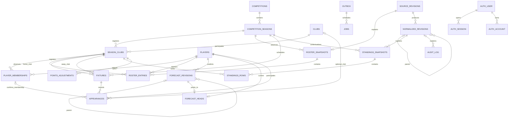

# Database

PostgreSQL 17 stores canonical football records, relational constraints, source
provenance, historical standings, authentication storage, and durable processing
metadata. The executable definitions are
[`001_football.sql`](../db/migrations/001_football.sql),
[`002_auth.sql`](../db/migrations/002_auth.sql),
[`003_grants.sql`](../db/migrations/003_grants.sql),
[`004_ingestion.sql`](../db/migrations/004_ingestion.sql),
[`005_rosters.sql`](../db/migrations/005_rosters.sql), and
[`006_forecasts.sql`](../db/migrations/006_forecasts.sql).

The app remains a process-only preview. An explicitly enabled worker imports
covered provider data, reconstructs standings, and processes durable ingestion
jobs and forecast refreshes using restricted runtime identities. Saved forecasts retain
their inputs and explanations; see [forecasting](forecasting.md). Login routes
remain unavailable. Authentication tables provide storage compatible with Better Auth's
core shape; they do not provide a login flow by themselves. See the
[ingestion guide](ingestion.md) for the MongoDB archive and recovery contract.

## Entity relationships



Each child has exactly one referenced parent unless the diagram marks that parent
optional (`o|`); a parent can have zero or more children (`o{`). Fixture home and
away references each identify a club registered in that fixture's season.
Optional canonical provenance links to `normalized_revisions` are omitted for
readability. `auth.verification` and the migration ledger are independent tables.

## Tables and keys

Football and processing tables live in `sports`, authentication tables in `auth`,
and the migration ledger in `infra`. Most `sports` tables have a generated UUID
primary key named `id`; `season_clubs` and `standings_rows` use composite keys,
and `ingestion_batches` uses its archive identifier. External identifiers remain text; `provider` defaults to
`apifootball`. Authentication primary keys are nonempty text.

| Table | Keys, relationships, and stored data |
| --- | --- |
| `sports.competitions` | Unique `(provider, provider_id)`; name, country, validated timezone, coefficient restricted to 1.5 or 2, explicit enabled flag |
| `sports.competition_seasons` | Competition FK; unique `(competition_id, label)`; ordered start/end dates, expected club count of at least two, explicit enabled flag |
| `sports.clubs` | Unique `(provider, provider_id)`; club name |
| `sports.season_clubs` | PK `(season_id, club_id)`; season and club FKs |
| `sports.players` | Unique `(provider, provider_id)`; name; position `GK`, `DEF`, `MID`, `FWD`, or `UNKNOWN` |
| `sports.player_memberships` | Player FK and registered season-club FK; half-open interval `[valid_from, valid_until)`, optionally open-ended; unique `(player_id, club_id, season_id, valid_from)` |
| `sports.fixtures` | Unique `(provider, provider_id)`; season and two registered season-club FKs; nullable kickoff/scores; separate fixture and statistics statuses |
| `sports.appearances` | Unique `(fixture_id, player_id)`; player FK; composite fixture-season and membership-player-club-season FKs; optional club/membership; participation, minutes, rating, and eight count metrics |
| `sports.source_revisions` | Unique MongoDB archive reference; provider, action, resource key, lowercase SHA-256 hash, retrieval time; unique `(provider, action, resource_key, content_sha256, retrieved_at)` retains distinct observations of matching content |
| `sports.normalized_revisions` | Source revision FK; entity type/key, content hash, optional same-entity parent; unique increasing identity ordinal; unique `(source_revision_id, entity_type, entity_key, content_sha256)` |
| `sports.standings_snapshots` | Season and required normalized revision FKs; local cutoff date, UTC cutoff instant, completeness flag; unique `(season_id, cutoff_local_date, normalized_revision_id)` |
| `sports.standings_rows` | PK `(snapshot_id, club_id)`; composite snapshot-season and registered season-club FKs; position/uncertainty, played/wins/draws/losses, goals, points |
| `sports.points_adjustments` | Registered season-club FK; signed nonzero points, effective time, reason, HTTPS provenance URL; optional normalized revision; unique `(season_id, club_id, effective_at, provenance_url)` |
| `sports.outbox` | Unique deduplication key; event and aggregate identifiers, JSON object payload, creation and optional publication times |
| `sports.jobs` | Outbox FK; unique deduplication key; kind, JSON object payload, status, attempts/limit, schedule, lease, error, completion time |
| `sports.audit_log` | Optional normalized revision FK; actor type/identifier, action, entity type/key, JSON object detail, occurrence time |
| `sports.ingestion_batches` | PK `archive_id`; source and optional normalized revision FKs; committed fixture/appearance counts and validation issues; durable SQL import marker |
| `sports.provider_requests` | UUID PK; approved provider action, credential-free resource key, attempted time; rolling-hour budget index |
| `sports.roster_snapshots` | UUID PK; season FK, unique source revision FK, original observation time, completeness and normalized revision; append-only |
| `sports.roster_entries` | PK `(snapshot_id, player_id, club_id)`; snapshot-season, registered season-club and player FKs; preserves conflicting club observations |
| `sports.forecast_revisions` | UUID PK and increasing ordinal; player FK; same-player earlier parent FK; model version, semantic hash, canonical source ordinal, cutoff, full input/provenance/result JSON objects; append-only |
| `sports.forecast_heads` | Player PK/FK and same-player revision FK; mutable current pointer and update time |
| `auth."user"` | Text PK; case-insensitive unique email, name, verification flag, optional image, `viewer`/`admin` role, creation/update times |
| `auth.session` | Text PK; unique nonempty token; user FK with cascading deletion; expiry after creation and optional client metadata |
| `auth.account` | Text PK; user FK with cascading deletion; unique `("providerId", "accountId")`; optional password/token fields |
| `auth.verification` | Text PK; nonempty identifier/value, expiry and creation/update times; identifier index |
| `infra.schema_migrations` | PK `filename`; lowercase SHA-256 checksum and application time; owned by `lsp_migrator` |

Stable clubs and players are separate from season registration and dated
membership. Repeated season keys allow composite FKs to reject cross-season
records. Appearance metrics use typed columns: `goals`, `assists`,
`shots_on_target`, `key_passes`, `tackles`, `interceptions`, `saves`, and
`goals_conceded`. SQL stores archive references and revision metadata, with raw
provider response storage reserved for MongoDB.

## Integrity and missing data

- A fixture cannot play a club against itself or use an unregistered club. An
  appearance belongs to its fixture's exact season, and any supplied club must be
  one of that fixture's sides.
- A supplied membership must match the appearance's player, club, and season.
  When kickoff is known, it must fall inside that membership's half-open interval.
  Deferred constraint triggers recheck appearance writes and changes to existing
  fixtures or memberships. A missing kickoff cannot prove temporal eligibility.
- Participation is `unknown`, `played`, or `dnp`. Both `played` and `dnp` require
  club and membership. Unknown participation can retain missing context. Minutes
  and count metrics are nullable and nonnegative when present; minutes have no
  90-minute upper limit. Rating is nullable or within 0–10. A DNP permits only
  null/zero metrics. Missing values never receive an automatic zero default.
- Fixture status is `unknown`, `scheduled`, `live`, `final`, `postponed`, or
  `cancelled`. Statistics status is independently `unknown`, `missing`, `partial`,
  or `complete`. A final fixture can still have missing scores or statistics.
- A standings cutoff must equal midnight in the competition's validated timezone
  and fall within the season dates. Rows reference registered clubs in that same
  season; ranks are between one and the expected club count. Played matches equal
  wins plus draws plus losses. Points can be negative and ranks can be tied, with
  an explicit uncertainty flag. A complete snapshot requires exactly the expected
  number of registered clubs and rows.
- Revision hashes are lowercase 64-character SHA-256 values. A normalized
  revision's parent belongs to the same entity and has a smaller ordinal,
  preventing cycles. Ordinals can contain gaps.
- Jobs enforce coherent attempts, leases, and completion state. A ready job has
  attempts remaining; a running job has an attempt and a complete lease; only
  terminal states have a completion time. Publication/completion cannot precede
  creation. The worker executes supported ingestion jobs and publishes their
  outbox records; the constraints enforce the stored lifecycle independently.

Context-changing writes require PostgreSQL's default `READ COMMITTED` isolation:
appearance inserts/updates, updates to existing fixture/membership context,
standings writes, club registration changes, and updates to competition/season
context. Relevant trigger entry points reject other isolation levels with
SQLSTATE `0A000`, including when no snapshots exist. Read-only queries can use
other isolation levels. Parent row locks protect appearance context, and a
transaction-scoped advisory lock serializes standings context checks. A deadlock
can still abort conflicting writes; retry the entire transaction.

Deferred constraints run at commit. Insert a complete snapshot and all its rows
in one transaction, or use `SET CONSTRAINTS ALL IMMEDIATE` to check them earlier.
Runtime corrections append new revisions/snapshots. Constraint functions use
invoker privileges and fixed search paths; they perform integrity validation.

## Database privileges

Provisioning creates four `LOGIN NOINHERIT` roles without superuser, role/database
creation, replication, or row-security bypass privileges. The migrator separately
receives database `CREATE` so it can own the application schemas. Runtime roles
have no membership in it. Database `PUBLIC` privileges and application schema,
table, and function privileges are revoked; runtime roles receive explicit grants.

| Login | Granted capability |
| --- | --- |
| `lsp_reader` | Read canonical football, source/normalized revisions, standings, points adjustments, rosters and forecasts; no writes or auth/outbox/jobs/audit access |
| `lsp_writer` | Read all `sports` tables; insert/update/delete canonical competitions, seasons, clubs, registration, players, memberships, fixtures, and appearances; append revisions, snapshots/rows, adjustments, audit, outbox, and jobs; update only outbox `published_at` and specified job lifecycle columns |
| `lsp_auth` | Read users; insert/update permitted profile fields with a default `viewer` role; CRUD sessions/accounts/verifications; no user deletion, role writes, football access, or migration access |
| `lsp_migrator` | Own schemas, tables, and constraint functions; manage the migration ledger and apply versioned SQL; reserved for controlled administration |

The writer may select/insert roster observations and forecast revisions, but
cannot update or delete them. It may insert a forecast head and update only its
revision pointer and update time. A revision parent must belong to the same player
and have a smaller ordinal. The current head comparison permits A to B to A input
corrections to append a third revision while exact replay remains idempotent.

The writer's job update columns are `status`, `attempts`, `max_attempts`,
`run_after`, `locked_by`, `locked_until`, `last_error`, and `completed_at`.
Provenance, snapshots/rows, adjustments, and audit are append-only for that role.
Ingestion batch markers and provider request reservations are also append-only;
the writer can select and insert them, but cannot update or delete them.
The auth role cannot insert or update `auth."user".role`; assigning an admin role
requires a controlled administrator. Audit actor identifiers are durable text,
so deleting an authentication user does not erase attribution. Database grants
do not implement route authorization or session checks.

Indexes cover provider-key deduplication, player/fixture history, dated
memberships, fixture lookup by season and home/away club, revision ancestry/entity
order, historical standings, effective adjustments, unpublished outbox records,
ready jobs/expired leases, audit history, email, sessions/accounts, and verification
identifiers.

## Provisioning and migrations

Use Node.js 24 and the committed lockfile. Follow the [local setup](../README.md)
to install dependencies and create an ignored `.env` from `.env.example`. Replace
all password placeholders before starting services. Database tooling uses
`POSTGRES_HOST`, `POSTGRES_PORT`, `POSTGRES_DB`, `POSTGRES_USER`, and the
`POSTGRES_BOOTSTRAP_PASSWORD`, `POSTGRES_READER_PASSWORD`,
`POSTGRES_WRITER_PASSWORD`, `POSTGRES_AUTH_PASSWORD`, and
`POSTGRES_MIGRATOR_PASSWORD` variables. These five passwords must be distinct,
private values of at least 16 characters. Defaults are host `127.0.0.1`, port
`5432`, database `sports`, and bootstrap user `sports_bootstrap`.

For a fresh local database, start PostgreSQL, wait for its authenticated health
check, then run both commands explicitly from the repository root:

```bash
docker compose up -d --wait postgres
npm run db:provision
npm run db:migrate
```

Provisioning uses the bootstrap administrator to create/reconfigure the four
logins, set their passwords/defaults, restrict database access, and grant schema
creation to the migrator. It refuses unexpected role memberships or application
roles owning the database. Re-running provisioning rotates those four passwords
to the configured values; app and worker receive no bootstrap/migration secrets.
The database remains owned by its bootstrap administrator.

For an existing managed database, preserve its data and apply only new migrations:

```bash
npm run db:migrate
```

This includes `004_ingestion.sql`, which adds cross-store commit markers and the
shared provider request ledger. Apply it before enabling ingestion. MongoDB
collection validators, indexes, and restricted runtime privileges are provisioned
separately with `npm run mongo:provision`; that command requires the local MongoDB
bootstrap credentials. The app receives none of these credentials, and the worker
receives only the runtime writer/ingestion credentials.

Do not remove volumes to upgrade a schema. Container replacement and ordinary
`docker compose down` preserve named volumes. Editing `.env` does not rotate the
initialized bootstrap password; that requires administrator-managed rotation.
Run provisioning again only when deliberately configuring/rotating its roles.

[`scripts/db.ts`](../scripts/db.ts) reads sequential `NNN_name.sql` files starting
at `001`, acquires a session advisory lock, and checks
`infra.schema_migrations`. Applied history must be a contiguous prefix of the
available files with identical SHA-256 checksums, including whitespace/comments.
Missing or edited applied files stop migration. Restore their original bytes and
add a new numbered migration for a correction.

Each new file and its ledger insert commit in one transaction; a failed file
rolls back its DDL and ledger entry. Previously committed files remain applied.
Re-running verifies existing history and applies only pending files. Migration
files must not contain top-level transaction control or top-level PostgreSQL
`E'...'` escape string literals. Each migration sets
`standard_conforming_strings=on` locally for ordinary strings. Dollar-quoted
strings and function bodies remain
supported, including escape strings inside those bodies. An alternate directory
can be supplied with `npm run db:migrate -- --dir path`. Existing unmanaged
`sports`/`auth`/`infra` schemas or an incorrectly owned ledger require administrator
review rather than automatic adoption or replacement.

## Isolated integration tests

[`tests/database.test.ts`](../tests/database.test.ts) verifies fresh migrations,
serialized reruns, checksum/history rejection, rollback and upgrades, invalid
relationships, missing/zero metrics, deferred and concurrent context checks,
operational state checks, and role boundaries. Tests provision cluster-wide roles
and create/drop test databases, so use a disposable PostgreSQL 17 cluster with no
demo or shared data.

The suite requires `NODE_ENV=test`, a database ending `_test`, and
`POSTGRES_TEST_CLUSTER_ID` matching that server's actual system identifier from
`pg_control_system()`. It checks these conditions and the PostgreSQL major version
before provisioning. It also rejects clusters containing other non-template
databases beyond `postgres` and the configured test database. The marker
identifies the intended cluster; it is not a password. The following Bash recipe
uses random passwords, an automatically assigned localhost port, temporary
storage, and cleanup of only its new container.
Run it after `npm ci`:

```bash
(
  set -eu
  export NODE_ENV=test POSTGRES_DB=sports_test
  export POSTGRES_USER=sports_test_bootstrap POSTGRES_HOST=127.0.0.1
  for db_test_credential in BOOTSTRAP READER WRITER AUTH MIGRATOR; do
    export "POSTGRES_${db_test_credential}_PASSWORD=$(node -e 'process.stdout.write(require("node:crypto").randomBytes(24).toString("hex"))')"
  done
  db_test_container=$(POSTGRES_PASSWORD="$POSTGRES_BOOTSTRAP_PASSWORD" docker run \
    --rm -d --tmpfs /var/lib/postgresql/data \
    --env POSTGRES_USER --env POSTGRES_DB --env POSTGRES_PASSWORD \
    --env POSTGRES_INITDB_ARGS=--auth-host=scram-sha-256 \
    -p 127.0.0.1::5432 postgres:17-alpine)
  trap 'docker rm -f "$db_test_container" >/dev/null 2>&1 || true' EXIT
  db_test_ready=0
  for db_test_attempt in {1..60}; do
    if docker exec "$db_test_container" sh -c \
      'PGPASSWORD="$POSTGRES_PASSWORD" psql -h 127.0.0.1 -U "$POSTGRES_USER" -d "$POSTGRES_DB" -Atqc "SELECT 1"' \
      >/dev/null 2>&1; then
      db_test_ready=1
      break
    fi
    sleep 1
  done
  [ "$db_test_ready" = 1 ] || { echo 'Temporary PostgreSQL did not become ready.' >&2; exit 1; }
  db_test_binding=$(docker port "$db_test_container" 5432/tcp)
  export POSTGRES_PORT="${db_test_binding##*:}"
  db_test_cluster_id=$(docker exec "$db_test_container" sh -c \
    'PGPASSWORD="$POSTGRES_PASSWORD" psql -h 127.0.0.1 -U "$POSTGRES_USER" -d "$POSTGRES_DB" -Atqc "SELECT system_identifier::text FROM pg_control_system()"')
  export POSTGRES_TEST_CLUSTER_ID="$db_test_cluster_id"
  npm run test:db
)
```

The [CI workflow](../.github/workflows/ci.yml) also runs the database suite in an
isolated PostgreSQL service. Lint, typecheck, and build require no database or
provider credentials. The separate [ingestion integration recipe](ingestion.md#isolated-integration-tests)
uses disposable PostgreSQL and MongoDB instances and exercises cross-store
recovery without a provider API key.
